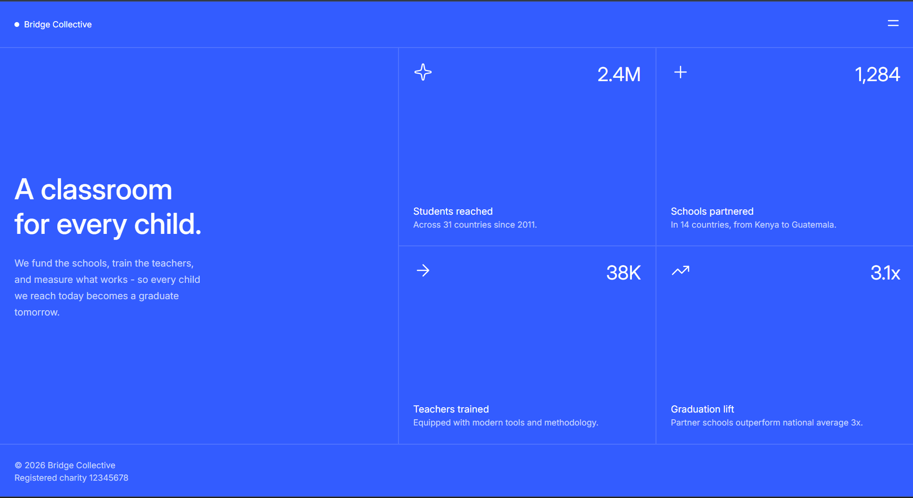

# Frontend Mentor - Grid landing page solution

This is a solution to the [Grid landing page challenge on Frontend Mentor](https://www.frontendmentor.io/challenges/grid-landing-page). Frontend Mentor challenges help you improve your coding skills by building realistic projects. 

## Table of contents

- [Overview](#overview)
  - [The challenge](#the-challenge)
  - [Screenshot](#screenshot)
  - [Links](#links)
- [My process](#my-process)
  - [Built with](#built-with)
  - [What I learned](#what-i-learned)
  - [AI Collaboration](#ai-collaboration)
- [Author](#author)

## Overview

### The challenge

Users should be able to:

- View the optimal layout for the page depending on their device's screen size
- See hover and focus states for all interactive elements on the page

### Screenshot



### Links

- Solution URL: [Add solution URL here](https://your-solution-url.com)
- Live Site URL: [Add live site URL here](http://127.0.0.1:3000/index.html)

## My process

### Built with

- Semantic HTML5 markup
- CSS custom properties
- Flexbox
- CSS Grid
- Mobile-first workflow
- [Styled Components](https://styled-components.com/) - For styles

### What I learned

This challenge improved my understanding of grid, flexbox, and responsive layout. 

```html
<div class="stat">
<div class="stat-head">
  
  <h3>2.4M</h3>
</div>
```
```css
/* NAVIGATION */
header nav {
    display: flex;
    flex-direction: row;
    justify-content: space-between;
    align-items: center;

    padding: var(--space-md);

    border-bottom: 2px solid var(--color-border);
}

/* STATS */

.stats {
    display: grid;
    grid-template-columns: 1fr;
}

/* RESPONSIVENESS */
@media screen and (min-width: 640px) {
  .stats {
    grid-template-columns: repeat(2, 1fr);
  }
}

@media screen and (min-width: 1024px) {
  main {
    display: grid;
    grid-template-columns: 1fr 1.3fr;

    height: 80vh;
  }
}
```

### AI Collaboration

During this challenge, I use **ChatGPT** as a helping tool. 
I used it for explaining about adding responsiveness in webpage, debugging the code. Grid, flexbox, spacing and other concepts worked well but, I had problem while adding height and width to the sections but with the help of AI tool, I got some understanding of using them. I am still working on this concept.

## Author
- Frontend Mentor - [@byharshitajain](https://www.frontendmentor.io/profile/byharshitajain)
- Twitter - [@Harshitaja48161]([https://www.twitter.com/yourusername](https://x.com/Harshitaja48161))
